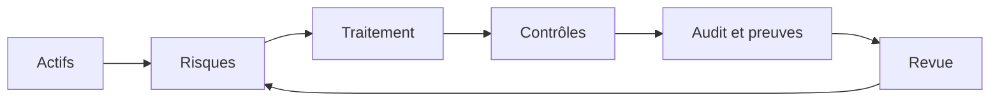

## Pourquoi un post sur la GRC

Ce cycle ne s'arrête jamais : les actifs changent, les menaces évoluent et chaque revue peut faire apparaître de nouveaux risques.
Jusqu'ici, mon entraînement et mes projets portent sur le versant technique de la sécurité : détecter, analyser, répondre. Mais une organisation ne se protège pas seulement avec des outils de détection. Il faut décider **quels risques accepter, quels contrôles mettre en place et comment prouver que ça fonctionne**. C'est là que la GRC intervient.

Ce post pose les bases de la GRC, explique comment elle s'articule avec la détection, puis présente **Eramba**, un outil GRC open source que j'ai déployé dans un lab pour simuler une démarche GRC.

## La GRC en trois mots

**GRC** signifie *Governance, Risk, Compliance* :

- **Gouvernance** : qui décide, selon quelles règles. Politiques de sécurité, rôles et responsabilités, objectifs.
- **Risque** : identifier ce qui peut mal tourner, évaluer la probabilité et l'impact, choisir comment traiter chaque risque (réduire, accepter, transférer, éviter).
- **Conformité** : démontrer que l'on respecte les exigences des référentiels (ISO 27001, NIST CSF ou PCI DSS) ou d'une réglementation.

Les trois sont liés : on évalue les risques pour choisir les contrôles, les contrôles servent à être conformes, et la gouvernance fixe les règles du jeu.

## Le cycle de gestion du risque

Ce cycle ne s'arrête jamais : les actifs changent, les menaces évoluent, et chaque revue peut faire apparaître de nouveaux risques.

## GRC et SOC : qui répond à quelle question

| Question                               | Côté GRC                                   | Côté SOC / détection                       |
| -------------------------------------- | ------------------------------------------ | ------------------------------------------ |
| Quels sont nos risques majeurs ?       | Registre des risques, évaluation           | Remontées d'alertes et de tendances        |
| Sommes-nous attaqués en ce moment ?    | —                                          | Surveillance, alertes, investigation       |
| Ce contrôle fonctionne-t-il vraiment ? | Suivi des contrôles, audits                | Logs et alertes qui servent de **preuves** |
| Que faire après un incident ?          | Revue du risque, mise à jour des contrôles | Réponse à incident, rapport                |

> La GRC ne détecte rien et un SIEM ne décide de rien. Chacun produit ce dont l'autre a besoin : le SOC fournit des faits, la GRC fournit le cadre pour en tirer des décisions.
{: .prompt-info }

Dans mon projet OSSIM, par exemple, une alerte de brute-force SSH est un fait technique. Dans une démarche GRC, ce même fait peut servir de preuve qu'un contrôle de surveillance des accès fonctionne, ou alimenter la réévaluation d'un risque lié aux accès distants.

## Eramba : présentation

Eramba est une plateforme GRC open source, disponible depuis 2015, qui propose une édition **Community** gratuite et une édition **Enterprise** payante. Ses principaux usages :

- **Gestion de la conformité** : suivi des exigences de référentiels comme ISO 27001, PCI DSS ou NIST
- **Gestion des risques** : risques liés aux actifs, aux tiers et à l'activité
- **Gestion des incidents**, sensibilisation, protection des données, revues de comptes

L'édition Community est présentée comme pleinement fonctionnelle, sans limite d'utilisateurs ni de données, mais avec des mises à jour, des sauvegardes à gérer soi-même et sans fonctionnalités avancées. Surtout, aucun support de la part de l'équipe d'Eramba. 

## Alternative ou complémentaire ?

Tout dépend de ce à quoi on compare Eramba. Dans notre cas, nous allons comparer nos anciennes méthodes de gestion des GRC, puis ensuite le comparer à un SIEM.

| Eramba comme... | Par rapport à                                  | Pourquoi                                                                                  |
| --------------- | ---------------------------------------------- | ----------------------------------------------------------------------------------------- |
| **Alternative** | Les tableurs (registre des risques sous Excel) | Historique, liens entre risques/contrôles/actifs, rappels, moins d'erreurs manuelles      |
| **Alternative** | Les plateformes GRC commerciales               | Pas de coût de licence en Community, pas de tarification par utilisateur                  |
| **Complément**  | Un SIEM comme OSSIM                            | Le SIEM détecte, Eramba suit les risques, les contrôles et les incidents qui en découlent |
| **Complément**  | Un scanner de vulnérabilités                   | Les vulnérabilités trouvées alimentent le registre des risques et leur plan de traitement |

**Limites à connaître :**
- L'interface est fonctionnelle plutôt que moderne, et la prise en main demande de comprendre le vocabulaire GRC.
- En Community, les mises à jour et les sauvegardes sont à ta charge.
- Certaines fonctions avancées sont réservées à l'Enterprise.
- Sans  personnes pour l'alimenter et revoir le registre, il reste vide.

## Mon lab : déploiement d'Eramba

### 1.Environnement

| Élément                | Détail                               |
| ---------------------- | ------------------------------------ |
| Hôte                   | machine virtuelle Eramba sous Ubuntu |
| Méthode d'installation | Docker Compose                       |
| Version d'Eramba       | 3.31.1                               |
| Édition                | Community                            |

### 2.Architecture déployée

L'installation via Docker Compose lance plusieurs conteneurs qui forment la plateforme :

- **eramba** : l'application web
- **mysql** : la base de données
- **cron** : les tâches planifiées
- **public_proxy** : le proxy d'accès

### 3.Étapes de mise en œuvre

1. La vm Eramba vient avec Docker et ses utilitaire
2.  configuration preliminaires (ports, variables d'environnement, adressage IP, mots de passe)
3. premier démarrage et vérification des conteneurs avec `docker-compose.simple-install.yml up -d`
4. première connexion à l'interface web et création du compte administrateur 

>Ce lab tourne dans un environnement virtuel isolé, avec des données uniquement fictives.
{: .prompt-warning }

### 4.Ce que j'ai simulé

J'ai simulé une démarche GRC avec Eramba Community, autour d’une microfinance fictive : GG Microfinance. L’objectif est de démontrer un parcours complet : de l’inventaire des actifs jusqu’à l’analyse de conformité.

#### Démarche suivie

Un groupe, sept utilisateurs aux rôles distincts (IT, réseau, opérations, conformité, crédit, agence, RH), six unités opérationnelles et cinq processus métier.

Quatre fournisseurs critiques : éditeur du core banking, opérateur télécom, prestataire de mobile money, hébergeur de sauvegardes.

Huit actifs classés par type : matériel, données, réseau, logiciel ; chacun avec un chargé.

Méthode de calcul du risque : calcul par matrice unique, probabilité × impact, avec seuil d’appétence au risque.

Risques : sept risques liés aux actifs et quatre risques liés aux tiers, avec menaces, vulnérabilités, traitement et risque résiduel.

Contrôles : huit contrôles de sécurité reliés aux risques (sauvegardes, MFA, revue des comptes, segmentation, sensibilisation, double validation, accès Wi-Fi, lien de secours).

Conformité : import d’un extrait de l’Annexe A de l’ISO/IEC 27001:2022 (43 exigences), puis rapprochement avec les contrôles.

#### Résultats attendus de l’analyse de conformité

Au cours de notre analyse de conformité, nous avons recensé trois grands points : certaines exigences couvertes par un contrôle (sauvegarde, authentification, etc); des exigences non-applicables et justifiées (développement logiciel et l’institution achetant son core banking) puis des écarts identifiés (gestion des vulnérabilités, journalisation et surveillance, etc).

Et pour finir nous avons le dashboard qui une fois remplis nous donne une vue d'ensemble sur la gestion des risques en cours 

## Ce que j'en retiens

Eramba dans sa structure et dans son fonctionnement est un logiciel très complet plus encore si nous avons besoin de piloter les certifications iso 27001 ou soc 2. Il est prédisposé pour cet usage, mais cela constitue aussi un inconvenant de la solution, car elle complique la gestion si nous le comparons à un outil comme simplerisk. Alors si votre objectif final est d'abord la matrice des risques alors penchez vous sur simplerisk. Mais l'objectif premier de ce poste est avant tout l'importance de la GRC et non la solution.

## Compétences démontrées

- Compréhension des trois piliers de la GRC et du cycle de gestion du risque
- Déploiement d'une application multi-conteneurs avec Docker Compose
- Prise en main d'un outil GRC open source
- Articulation entre détection technique (SOC) et gouvernance du risque

## Conclusion et pistes d'amélioration

La GRC donne le cadre dans lequel la détection prend son sens : sans elle, on collecte des alertes sans savoir lesquelles comptent vraiment pour l'organisation. 

---

*Lab réalisé en environnement virtuel isolé, sans aucune donnée réelle.*
